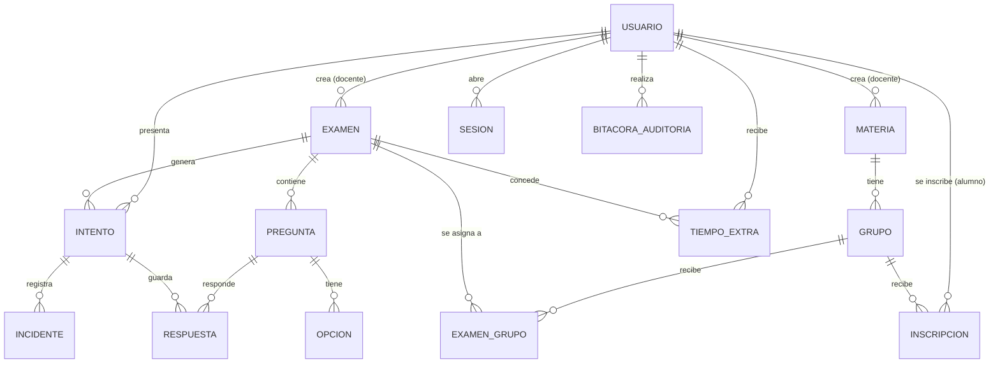

# Modelo de datos
## Plataforma web para la aplicación segura de exámenes asíncronos (Tecnológico de Cuautla)

**Base de datos:** PostgreSQL · **Backend:** JavaScript (Node.js, Express) con Prisma, Knex o `pg`

## 1. Diagrama entidad-relación

## 2. Tablas

### usuario
| Campo | Tipo | Notas |
|---|---|---|
| id | bigint PK | |
| nombre_usuario | varchar(50) | Único |
| contrasena_hash | varchar(255) | Hash (por ejemplo, BCrypt); nunca la contraseña |
| rol | varchar(10) | `ADMIN`, `DOCENTE`, `ALUMNO` |
| activo | boolean | El administrador desactiva docentes |
| creado_en | timestamp | |

### materia
| Campo | Tipo | Notas |
|---|---|---|
| id | bigint PK | |
| docente_id | bigint FK → usuario | Dueño de la materia |
| nombre | varchar(120) | |

### grupo
| Campo | Tipo | Notas |
|---|---|---|
| id | bigint PK | |
| materia_id | bigint FK → materia | |
| nombre | varchar(80) | |
| codigo_inscripcion | varchar(12) | Único; lo comparte el docente |
| activo | boolean | |

### inscripcion
| Campo | Tipo | Notas |
|---|---|---|
| id | bigint PK | |
| grupo_id | bigint FK → grupo | |
| alumno_id | bigint FK → usuario | |
| creado_en | timestamp | |

Restricción única: (`grupo_id`, `alumno_id`).

### examen
| Campo | Tipo | Notas |
|---|---|---|
| id | bigint PK | |
| docente_id | bigint FK → usuario | Solo este docente ve sus datos |
| titulo | varchar(150) | |
| instrucciones | text | |
| abre_en | timestamp | Inicio de la ventana |
| cierra_en | timestamp | Fin de la ventana (puede ser varios días después) |
| duracion_min | int | Define el docente |
| mostrar_respuestas | boolean | Si el alumno ve las correctas al terminar |
| umbral_inactividad_min | int | Minutos de inactividad que anulan el examen |
| permite_herramienta | boolean | Excepción, por ejemplo calculadora integrada (desactivada por defecto) |
| estado | varchar(12) | `BORRADOR`, `PROGRAMADO`, `CERRADO` |

### examen_grupo
| Campo | Tipo | Notas |
|---|---|---|
| examen_id | bigint FK → examen | |
| grupo_id | bigint FK → grupo | |

Llave primaria compuesta: (`examen_id`, `grupo_id`).

### pregunta
| Campo | Tipo | Notas |
|---|---|---|
| id | bigint PK | |
| examen_id | bigint FK → examen | |
| orden | int | Orden base; se baraja por alumno |
| tipo | varchar(20) | `ABIERTA`, `OPCION_MULTIPLE`, `VERDADERO_FALSO` |
| enunciado | text | |
| imagen_ruta | varchar(255) | Opcional; archivo guardado en el servidor |
| puntos | numeric(5,2) | |

### opcion
| Campo | Tipo | Notas |
|---|---|---|
| id | bigint PK | |
| pregunta_id | bigint FK → pregunta | |
| texto | text | |
| es_correcta | boolean | **Nunca se envía al navegador durante el examen** |
| orden | int | |

### tiempo_extra
| Campo | Tipo | Notas |
|---|---|---|
| examen_id | bigint FK → examen | |
| alumno_id | bigint FK → usuario | |
| minutos | int | 1 a 240; asignado por el docente antes de que el alumno inicie |

Llave primaria compuesta: (`examen_id`, `alumno_id`). Al crear el intento, `minutos` se copia a `intento.tiempo_extra_min`. *(Agregada en la Fase 4: el intento no existe hasta que el alumno inicia, y RF-16 pide asignar el tiempo antes.)*

### intento
| Campo | Tipo | Notas |
|---|---|---|
| id | bigint PK | |
| examen_id | bigint FK → examen | |
| alumno_id | bigint FK → usuario | |
| estado | varchar(12) | `EN_CURSO`, `ENVIADO`, `ABANDONADO`, `ANULADO`, `REABIERTO` |
| inicio_en | timestamp | El servidor calcula el tiempo restante a partir de aquí |
| fin_en | timestamp | |
| tiempo_extra_min | int | Asignado por el docente |
| semilla_aleatoria | bigint | Reproduce el orden barajado de este alumno |
| posicion | int | Índice de la pregunta actual en el orden barajado; solo avanza (RF-23). *(Agregada en la Fase 5.)* |
| plagio_confirmado | boolean | El docente confirmó el plagio: la anulación es definitiva. Se guarda aquí porque la evidencia (`incidente`) se borra a la semana. *(Agregada en la Fase 7.)* |
| ip_inicio | varchar(45) | IP al iniciar (IPv4 o IPv6) |
| calificacion | numeric(5,2) | |
| publicado | boolean | Si el alumno ya puede ver su resultado |

Restricción única: (`examen_id`, `alumno_id`), que garantiza **una sola oportunidad**. Reabrir cambia el estado a `REABIERTO`.

### respuesta
| Campo | Tipo | Notas |
|---|---|---|
| id | bigint PK | |
| intento_id | bigint FK → intento | |
| pregunta_id | bigint FK → pregunta | |
| opcion_id | bigint FK → opcion | Para preguntas cerradas |
| texto_respuesta | text | Para preguntas abiertas |
| puntos_obtenidos | numeric(5,2) | Automático (cerradas) o manual (abiertas) |
| comentario_docente | text | |
| guardada_en | timestamp | Autoguardado |

Restricción única: (`intento_id`, `pregunta_id`); el autoguardado actualiza la fila.

### incidente (evidencia)
| Campo | Tipo | Notas |
|---|---|---|
| id | bigint PK | |
| intento_id | bigint FK → intento | |
| tipo | varchar(20) | `CAMBIO_PESTANA`, `INACTIVIDAD`, `SESION_DUPLICADA`, `CONEXION_PERDIDA` |
| ocurrio_en | timestamp | |
| ip | varchar(45) | |
| dispositivo | varchar(255) | Navegador y sistema (user agent) |
| decision | varchar(12) | `PENDIENTE`, `CONFIRMADO`, `DESCARTADO` |
| revisado_por | bigint FK → usuario | Docente |
| revisado_en | timestamp | |
| expira_en | timestamp | `ocurrio_en` + 7 días; un proceso diario borra los vencidos |

### sesion
| Campo | Tipo | Notas |
|---|---|---|
| id | bigint PK | |
| usuario_id | bigint FK → usuario | |
| token_hash | varchar(255) | |
| expira_en | timestamp | |
| activa | boolean | Una sola sesión activa por alumno |

### bitacora_auditoria
| Campo | Tipo | Notas |
|---|---|---|
| id | bigint PK | |
| usuario_id | bigint FK → usuario | Quién |
| accion | varchar(40) | Por ejemplo: `REABRIR_EXAMEN`, `CALIFICAR`, `CREAR_DOCENTE` |
| entidad / entidad_id | varchar / bigint | Sobre qué |
| detalle | text | |
| creado_en | timestamp | |

## 3. Reglas que el modelo garantiza

- **Una sola vez:** restricción única (`examen_id`, `alumno_id`) en `intento`.
- **Tiempo en el servidor:** el tiempo restante se calcula con `inicio_en`, `duracion_min` y `tiempo_extra_min`, no con el reloj del navegador.
- **Aleatorización sin banco:** `semilla_aleatoria` permite barajar preguntas y opciones por alumno de forma reproducible.
- **Control de acceso:** toda consulta de exámenes, intentos y reportes filtra por `docente_id` del examen.
- **Retención de evidencias:** `incidente.expira_en` y un proceso programado de borrado; las calificaciones (`intento`, `respuesta`) no se borran.
- **Privacidad:** solo se guarda usuario, contraseña con hash e IP como evidencia.

## 4. Índices recomendados

- `usuario(nombre_usuario)` único.
- `grupo(codigo_inscripcion)` único.
- `intento(examen_id, alumno_id)` único y `intento(estado)`.
- `respuesta(intento_id, pregunta_id)` único.
- `incidente(intento_id)` e `incidente(expira_en)`.
- `sesion(usuario_id, activa)`.
- Los accesos por `docente_id` en `materia` y `examen`.

## 5. Pendientes que pueden cambiar el modelo

- **Alcance del plagio:** si también se compara texto entre alumnos, se necesita una tabla de similitud entre respuestas.
- **Respaldo del alumno al cambiar de IP:** si se quiere registrar más de una IP por intento, `ip_inicio` pasaría a la tabla `incidente` o a una tabla de eventos.
- **Umbral de inactividad:** confirmar si es por examen (como está) o global.
